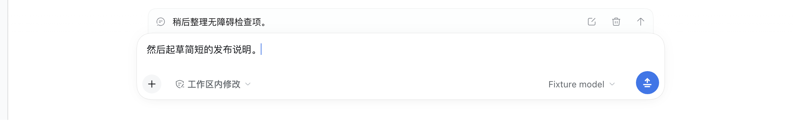

# Queue send indicator

[简体中文](README.zh.md)

While the agent is busy, the **Send** button shows an arrow above two stacked lines when Enter would queue the draft.
Hold Cmd or Ctrl to preview the complementary **Mod+Enter** action.
Release it to return to the default icon.
Clicking still uses the native default send action, even while a modifier is held.
The plugin does not change either shortcut.

Requires the Web client on DeepSeek Harness `0.2.2-rc.5`.
Enable **Queue send indicator** in Session Atlas.
To install it on its own, run `npm ci` in this checkout and choose the directory in **Plugins → Add plugin**.
Use one installation route so the plugin has only one entry.

## Screenshots

While the agent is busy, the queued message appears above the draft and the send button shows the queue icon.
The screenshots show the Chinese interface.

| | Light | Dark |
| --- | --- | --- |
| Composer during generation |  |  |

[Project documentation](docs/README.md)
