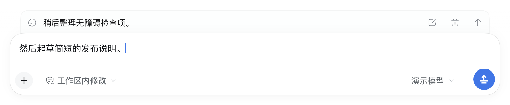

While the agent is running, the queue icon on Send shows when pressing that shortcut will queue the draft.

[View user guide](https://github.com/miorin-chan/dsh-composer-queue-indicator/blob/main/README.md)
